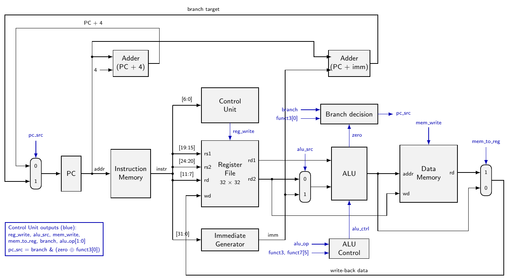

# Single-Cycle RV32I Processor

CSA-222 Modern Computer Architecture, Project 1. A small single-cycle RISC-V processor written in Verilog. It runs ten RV32I instructions:

`ADD` `SUB` `AND` `OR` `XOR` `ADDI` `LW` `SW` `BEQ` `BNE`

**Team:** Rishi Raj (2401010380), Yash Yadav (2401010515), Aditya Samadhiya (2401010037), Kaustubh Ranjan Mishra (2401020116), Yash Raj (2401010514)

**Final report:** [docs/report_final.pdf](docs/report_final.pdf) (Phase I report: [docs/report_phase1.pdf](docs/report_phase1.pdf))

**Demo video:** [Google Drive Link](https://drive.google.com/file/d/1IhI9AuI-NJyWOLgHf0MOzuwAFhSgHOxk/view?usp=sharing)



## Results at a glance

| | |
|---|---|
| Functional checks | 169 across 8 testbenches, all passing |
| Test programs | 4, including two corner-case programs |
| FPGA target | Lattice ECP5 LFE5U-25F (Yosys + nextpnr) |
| Look-up tables | 1772 of 24288 (7%) |
| Flip-flops | 32 |
| Maximum clock frequency | 52.8 MHz (18.9 ns period) |
| Critical path | conditional branch: PC, instruction memory, register file, ALU, zero detect, PC |
| Run on a physical board | no, no board was available |

Details: [docs/synthesis_report.md](docs/synthesis_report.md) and [docs/timing_report.md](docs/timing_report.md).

## What's in the repo

```
rtl/         the processor, one module per file
tb/          self-checking testbenches
programs/    test programs: .s is the assembly, .hex is what gets loaded
synth/       synthesis script, and reports/ with the tool output
fpga/        board wrapper for running the processor on an FPGA
docs/        reports (PDF + LaTeX source), block diagram, waveforms, team plan
Makefile     shortcuts for simulation, synthesis and place and route
```

| Module | File | What it does |
|---|---|---|
| Program counter | `rtl/pc.v` | Holds the address of the current instruction |
| Adder | `rtl/adder.v` | PC + 4 and PC + immediate |
| Instruction memory | `rtl/instr_mem.v` | ROM loaded from a `.hex` file |
| Control unit | `rtl/control_unit.v` | Opcode to control signals |
| Register file | `rtl/reg_file.v` | 32 registers, `x0` fixed at zero |
| Immediate generator | `rtl/imm_gen.v` | Sign-extends I, S and B immediates |
| ALU control | `rtl/alu_control.v` | Picks the ALU operation from funct3 / funct7 |
| ALU | `rtl/alu.v` | add, sub, and, or, xor, zero flag |
| 2:1 mux | `rtl/mux2.v` | ALU source, write-back and next-PC selection |
| Data memory | `rtl/data_mem.v` | RAM for `LW` / `SW` |
| Top level | `rtl/rv32i_top.v` | Wires everything together |
| Board wrapper | `fpga/fpga_top.v` | Slow clock and PC on eight LEDs |

## Running the simulations

You need [Icarus Verilog](https://steveicarus.github.io/iverilog/) and, for waveforms, GTKWave. Run everything from the repository root (the hex file paths are relative to it).

```
make            # every testbench
make top        # full processor, program 1 (arithmetic, load, store)
make top2       # full processor, program 2 (loop with branches)
make top3       # full processor, program 3 (datapath corner cases)
make top4       # full processor, program 4 (branch corner cases)
make alu        # one unit test; also: fetch reg_file imm_gen control_unit data_mem
make fpga       # board wrapper
```

Without `make` (for example on Windows):

```
iverilog -o top.out rtl/*.v tb/tb_rv32i_top.v
vvp top.out
```

Add `-DPROG2`, `-DPROG3` or `-DPROG4` to the `iverilog` line to pick the program, and `-DQUIET` to switch off the per-cycle trace. On Windows `cmd`, list the files in `rtl` one by one, or use Git Bash.

Each testbench prints `ALL TESTS PASSED` or the list of failed checks, and a failed run exits with a non-zero status. The top-level testbench also prints how many cycles the program took to reach its halt instruction. The `$readmemh ... Not enough words` warning is expected: the programs are shorter than the 64-word memory.

### Waveforms

Run a testbench and open the `.vcd` file it writes:

```
gtkwave tb_rv32i_top.vcd
```

To get the same view as the figures in the report, with the signals already added:

```
gtkwave -r docs/waves/gtkwaverc -S docs/waves/capture.tcl tb_rv32i_top.vcd
```

This saves `wave.png` and closes. The two screenshots used in the report are in `docs/waves/`.

## Test programs

| Program | What it tests | Cycles | Expected result |
|---|---|---|---|
| `prog1_arith` | ADDI, ADD, SUB, AND, OR, XOR, SW, LW on 10 and 6 | 14 | x3=16, x4=4, x5=2, x6=14, x7=12, x8=-3, x11=20, mem[8]=20 |
| `prog2_loop` | Sum 5+4+3+2+1 in a loop; BEQ and BNE, taken and not taken | 24 | x2=15, x6=1 (self-check passed), mem[0]=15 |
| `prog3_corner` | Immediates at +2047 and -2048, writes to x0, signed overflow, negative offsets, last memory word | 119 | x4=0, x8=0x80000000, x11=-4095, mem[252]=0xFFFFFFFF, and 18 more |
| `prog4_branch` | Eight self-checked branch cases, a backward BEQ, a nested loop computing 6 x 7 | 169 | x31=8 (checks passed), x30=0, x12=42 |

Programs are assembled by hand. Each line of a `.hex` file has the assembly next to it as a comment, and a program ends with `beq x0, x0, 0`, a branch to itself, which acts as halt. The full list of expected values is at the top of each `.s` file.

## Synthesis and timing

You need [Yosys](https://yosyshq.net/yosys/) and nextpnr-ecp5.

```
make synth      # writes synth/reports/resources_total.txt and resources_per_module.txt
make pnr        # place and route, writes synth/reports/nextpnr_ecp5.log
```

The maximum frequency and the critical path are near the end of `nextpnr_ecp5.log`. For synthesis the instruction memory is filled with random words (`synth/rom_random.hex`) so that the tool cannot remove logic that one particular program happens not to use.

## Running on an FPGA

We did not have a board, so this is untested on hardware. `fpga/fpga_top.v` is a wrapper with three ports: `clk` (board oscillator), `reset` (push button, active high) and `led[7:0]`. It slows the clock to a few hertz and shows PC / 4 on the LEDs. To use it, add the constraint file for your board that maps those three ports to pins, and set the `MEM_FILE` parameter to the program you want.

## Contributions

| Member | Phase I | Phase II |
|---|---|---|
| Rishi Raj (2401010380) | `pc`, `adder`, `instr_mem`, `tb_fetch`, programs 1 and 2 | Programs 3 and 4, instruction memory fix for synthesis |
| Yash Yadav (2401010515) | `reg_file`, `imm_gen`, `tb_reg_file`, `tb_imm_gen` | Immediate limit tests, waveform capture script and figures |
| Aditya Samadhiya (2401010037) | `alu`, `alu_control`, `tb_alu`, block diagram | ALU corner-case tests, synthesis script and resource report |
| Kaustubh Ranjan Mishra (2401020116) | `control_unit`, `mux2`, `tb_control_unit` | Place and route, critical path and clock frequency analysis |
| Yash Raj (2401010514) | `data_mem`, `rv32i_top`, `tb_data_mem`, `tb_rv32i_top`, Makefile | Four-program top-level testbench, FPGA wrapper, build flow, final report |
