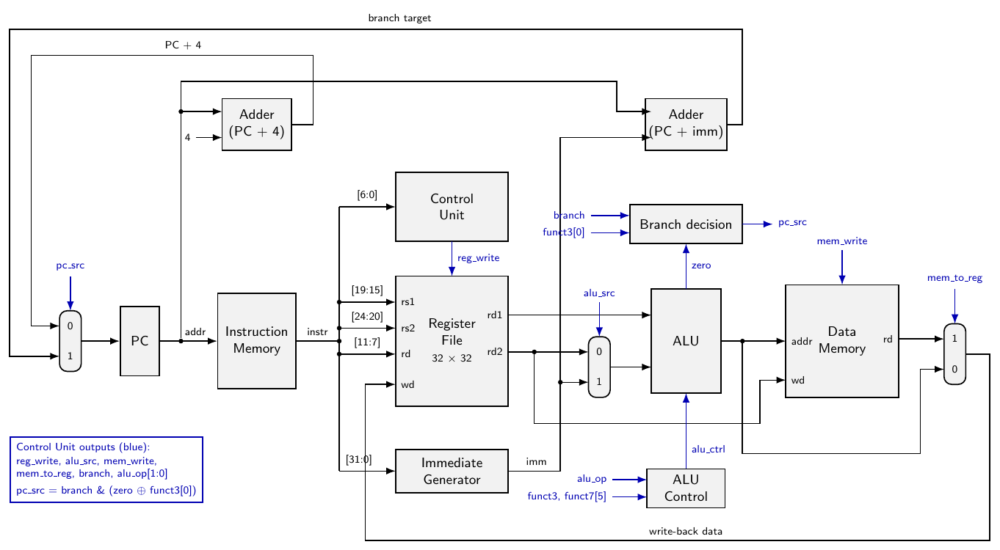

# Single-Cycle RV32I Processor

CSA-222 Modern Computer Architecture, Project 1. A small single-cycle RISC-V processor written in Verilog. It runs ten RV32I instructions:

`ADD` `SUB` `AND` `OR` `XOR` `ADDI` `LW` `SW` `BEQ` `BNE`

**Team:** Rishi Raj (2401010380), Yash Yadav (2401010514), Aditya Samadhiya (2401010037), Kaustubh Mishra (2401020116), Yash Raj (2401010514)

**Phase I report:** [docs/report_phase1.pdf](docs/report_phase1.pdf)

**Demo video:** _paste link here_



## What's in the repo

```
rtl/         the processor, one module per file
tb/          one self-checking testbench per part of the datapath
programs/    test programs: .s is the assembly, .hex is what gets loaded
docs/        report (PDF + LaTeX source), block diagram, video script, team plan
Makefile     shortcuts for running the simulations
```

| Module | File | What it does |
|---|---|---|
| Program counter | `rtl/pc.v` | Holds the address of the current instruction |
| Adder | `rtl/adder.v` | PC + 4 and PC + immediate |
| Instruction memory | `rtl/instr_mem.v` | ROM loaded from a `.hex` file |
| Control unit | `rtl/control_unit.v` | Opcode to control signals |
| Register file | `rtl/reg_file.v` | 32 registers, `x0` fixed at zero |
| Immediate generator | `rtl/imm_gen.v` | Sign-extends I, S and B immediates |
| ALU control | `rtl/alu_control.v` | Picks the ALU operation from funct3 / funct7 |
| ALU | `rtl/alu.v` | add, sub, and, or, xor, zero flag |
| 2:1 mux | `rtl/mux2.v` | ALU source, write-back and next-PC selection |
| Data memory | `rtl/data_mem.v` | RAM for `LW` / `SW` |
| Top level | `rtl/rv32i_top.v` | Wires everything together |

## Running it

You need [Icarus Verilog](https://steveicarus.github.io/iverilog/) and, for waveforms, GTKWave. Run everything from the repository root (the hex file paths are relative to it).

```
make            # every testbench
make top        # full processor, program 1 (arithmetic, load, store)
make top2       # full processor, program 2 (loop with branches)
make alu        # one unit test; also: fetch reg_file imm_gen control_unit data_mem
```

Without `make` (for example on Windows):

```
iverilog -o top.out rtl/*.v tb/tb_rv32i_top.v
vvp top.out
```

Add `-DPROG2` to the `iverilog` line to run program 2. On Windows `cmd`, list the files in `rtl` one by one, or use Git Bash.

Each testbench prints `ALL TESTS PASSED` or the list of failed checks. The `$readmemh ... Not enough words` warning is expected: the programs are shorter than the 64-word memory.

To see waveforms, run a testbench and open the `.vcd` file it writes:

```
gtkwave tb_rv32i_top.vcd
```

Useful signals to add: `dbg_pc`, `dbg_instr`, `dbg_alu_result`, the control signals inside `dut`, and `dut.u_reg_file.regs`.

## Test programs

| Program | What it tests | Expected result |
|---|---|---|
| `prog1_arith` | ADDI, ADD, SUB, AND, OR, XOR, SW, LW on 10 and 6 | x3=16, x4=4, x5=2, x6=14, x7=12, x8=-3, x11=20, mem[8]=20 |
| `prog2_loop` | Sum 5+4+3+2+1 in a loop; BEQ and BNE, taken and not taken | x2=15, x6=1 (self-check passed), mem[0]=15 |

Programs are assembled by hand. Each line of a `.hex` file has the assembly next to it as a comment, and a program ends with `beq x0, x0, 0`, a branch to itself, which acts as halt.

## Phase I status

- All eleven RTL modules written
- Seven testbenches, all passing
- Both programs run correctly on the integrated processor

## Planned for Phase II

- More test programs for corner cases
- Synthesis and resource report
- Critical path and clock frequency observations
- FPGA run if a board is available

## Contributions

| Member | RTL and testbenches | Report |
|---|---|---|
| Rishi Raj (2401010380) | `pc`, `adder`, `instr_mem`, `tb_fetch`, both test programs | Abstract, Introduction |
| Yash Yadav (2401010514) | `reg_file`, `imm_gen`, `tb_reg_file`, `tb_imm_gen` | Literature Review |
| Aditya Samadhiya (2401010037) | `alu`, `alu_control`, `tb_alu` | Instruction subset, Datapath, block diagram |
| Kaustubh Mishra (2401020116) | `control_unit`, `mux2`, `tb_control_unit` | Control section and truth table |
| Yash Raj (2401010514) | `data_mem`, `rv32i_top`, `tb_data_mem`, `tb_rv32i_top`, Makefile | Verification section, repo, video editing |
